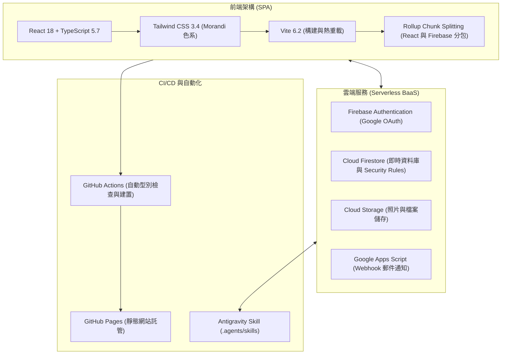

# 🌿 我們的小組手帳 Cozy Scrapbook

<div align="center">


<br/>

**專屬於成青小組的日常聚會與生活記錄協作平台**

👉 **[立即進入手帳 (線上正式環境)](https://hunk0724.github.io/streamside-tree-scrapbook/)** 👈

</div>

---

## 📖 專案簡介 (Overview)

「小組手帳」是成青小組內部使用的私密協作平台，提供聚會提案投票、活動照片與共用素材收納、生活小動態分享，以及組員功能許願池。

介面設計採用手帳剪貼風格（莫蘭迪色調、手寫字體、拍立得排版與紙膠帶視覺元素），搭配前端身分驗證與後端資料庫權限規則，確保小組內容的私密性與操作便利。

---

## ✨ 核心功能 (Features)

### 💡 1. 每月聚會提案板 (Proposals)
- **發起提案**：組員可隨時提出聚會構想（如野餐、桌遊之夜、踏青）。
- **即時投票**：點擊愛心為喜歡的活動投票，依票數即時排序。
- **全員協同編輯**：每位核可組員皆可編輯活動時間、地點與攜帶物品，卡片會保留最後編輯者資訊（例如：`由 怡蓁 於 9/30 補充編輯`）。
- **提案討論串**：卡片內建留言區，供大家討論活動細節。
- **定案標記**：管理員可將確定舉辦的方案標記為「🌟 本月最終決定」。

### 📸 2. 活動紀錄與素材牆 (Records)
- **拍立得照片牆**：上傳聚會照片，以隨機角度微傾斜的拍立得卡片展示。
- **雲端圖檔儲存**：串接 Firebase Cloud Storage，支援直接上傳常用照片格式。
- **共用文件與素材**：支援貼上外部雲端硬碟或簡報連結，集中管理活動資源。
- **分類篩選**：可依「全部顯示」、「📸 拍立得照片」與「📎 共用素材」切換檢視。

### 📝 3. 日常動態 (Updates)
- **生活隨手記**：分享日常近況、感恩小事或代禱事項。
- **圖文混排**：支援純文字與附圖發佈，紀錄小組生活點滴。

### ✨ 4. 功能許願池 (Wishes & Feedback Loop)
- **功能許願**：組員可提出期望新增的手帳功能。
- **集氣機制**：組員可針對想要的項目點擊「+1 集氣」，讓熱門需求優先排序。
- **進度追蹤**：公開標示處理狀態（💡 許願中 ➔ 🛠️ 實現中 ➔ 🎉 已實現）。
- **上線改動摘要**：願望實現後，卡片自動展示版本標籤（如 `v1.1.1`）與具體改動說明。
- **體驗回饋**：組員可在願望卡片下方留言討論使用感受，維持持續改善機制。

### 🛡️ 5. 存取權限與安全機制 (Security)
- **Google OAuth 登入**：透過 Google 帳號驗證身分，避免未授權訪客存取。
- **審核閘門**：初次登入的新使用者預設為待審核狀態，需由管理員於後台核可後方能存取完整手帳內容。
- **資料庫權限邊界**：配置 Firestore Security Rules，在資料庫層限制只有管理員能修改審核狀態與角色，避免跳過前端審核自行提權。
- **即時通知聯動**：組員送出申請時，透過 Google Apps Script Webhook 自動發送郵件通知管理員。
- **環境變數隔離**：管理員信箱與通知 Webhook 皆抽離至環境變數，避免機敏資訊直接寫入前端原始碼或版本庫。

---

## 🛠️ 技術架構 (Tech Stack)



- **前端**：React 18、TypeScript 5.7、Tailwind CSS 3.4
- **建置工具**：Vite 6.2（設定 React 核心與 Firebase SDK 分離打包，提升快取利用率）
- **後端服務**：Firebase Authentication、Cloud Firestore、Firebase Storage
- **自動化部署**：GitHub Actions（每次推送 main 分支時執行 `npm ci` ➔ `tsc` 型別檢查 ➔ `vite build` ➔ 自動發布至 GitHub Pages）
- **許願池檢索腳本**：專案內建命令（`npm run check-wishes`），便於快速檢查待處理的組員需求。

---

## 🚀 本地開發指南 (Local Development)

### 1. 環境需求
- [Node.js](https://nodejs.org/) (建議 v20 或 v22 以上)
- [Git](https://git-scm.com/)

### 2. 下載專案並安裝套件
```bash
# 複製專案倉庫
git clone https://github.com/Hunk0724/streamside-tree-scrapbook.git

# 進入專案目錄
cd streamside-tree-scrapbook

# 安裝依賴套件
npm ci
```

### 3. 設定本地環境變數
```bash
# 複製範本檔案為 .env.local
cp .env.example .env.local
```
開啟 `.env.local` 並填入對應的設定值：
- `VITE_ADMIN_EMAIL`：管理員 Google 帳號 Email
- `VITE_NOTIFICATION_WEBHOOK_URL`：Google Apps Script 發信 Webhook 網址

*(註：`.env.local` 與本地 `firestore.rules` 皆已加入 `.gitignore`，不會被推送到公開儲存庫)*

### 4. 啟動開發伺服器
```bash
npm run dev
```
啟動後打開瀏覽器訪問 `http://localhost:3000/streamside-tree-scrapbook/` 即可進行開發。

### 5. 生產環境建置與檢查
```bash
npm run build
```
會同時執行 TypeScript 嚴格型別檢查 (`tsc`) 與 Vite 生產打包 (`vite build`)。

### 6. 檢索許願池狀態
```bash
npm run check-wishes
```
在終端機快速檢視組員最新發起與集氣中的願望清單。

---

## 🤝 協作準則 (Collaboration Rules)

本專案直接部署至正式環境，開發流程遵循 [GEMINI.md](file:///d:/projects/river_tree_web/GEMINI.md) 規範：
1. **需求理解**：確認改動目標與影響範圍。
2. **方案評估**：動手前評估實作架構與復原方式。
3. **決策確認**：提出方案後先經確認再行修改。
4. **謹慎實作**：維持 TypeScript 型別嚴謹度與既有程式碼風格。
5. **部署前驗證**：本地驗證通過，經授權後才執行 `git commit` 與 `git push`。

---

## 📜 版本發布歷史 (Release History)

- **`v1.1.1` (2026-10-13)**：
  - 🛡️ 修復 Firestore Security Rules 權限漏洞，在資料庫層禁止非管理員自行修改審核狀態與角色。
  - 🔑 將管理員信箱與通知 Webhook 抽離為環境變數（`.env.local` / GitHub Secrets），降低原始碼暴露風險。
  - 🧹 移除過期的舊版單檔 `index.legacy.html`，維持程式庫乾淨。
  - 📝 更新本地開發說明，加入環境變數配置步驟。
- **`v1.1.0` (2026-09-30)**：
  - ✨ 新增「提案全員協同編輯」功能，並留存最後編輯者足跡。
  - 📝 許願池增加「功能上線改動摘要」與「版本標籤」。
  - 💬 許願池開放「使用體驗回饋留言串」。
  - 🤖 建立專案專屬 Antigravity Skill (`.agents/skills/check-wishes`)。
  - 🏷️ 導入專案語意化版本號（SemVer）。
- **`v1.0.0` (2026-09-30)**：
  - 🏗️ 完成現代化架構遷移（由單檔 HTML 重構為 Vite + React + TypeScript + Tailwind CSS）。
  - 🚀 建立 GitHub Actions CI/CD 自動化建置與 GitHub Pages 部署流程。
  - 🛡️ 實作成員審核系統與 Firebase 基礎規則防護。

---

<div align="center">
  <p>🌿 成青小組的小手帳 · 記錄小組的日常與聚會點滴</p>
</div>
